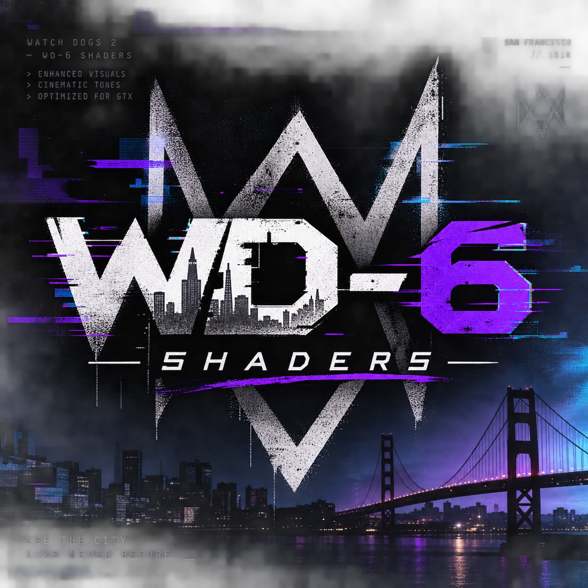

# WD-6

 

 A watch dogs 2 shaders made to look realistic (ish), made with ChatGPT.

 Key points to note, runs only on official Watch Dogs 2, use "ENABLE_VKBASALT=1 %command%" command in 'properties' of steam in watch dogs 2 and paste the resorcepack to the data_win64 to run it, also, use the reference of the above two attached screenshots to tweak the ingame graphics to get the full experience.

Made and owned by,

aplx-renz-sudo (R3nz)
